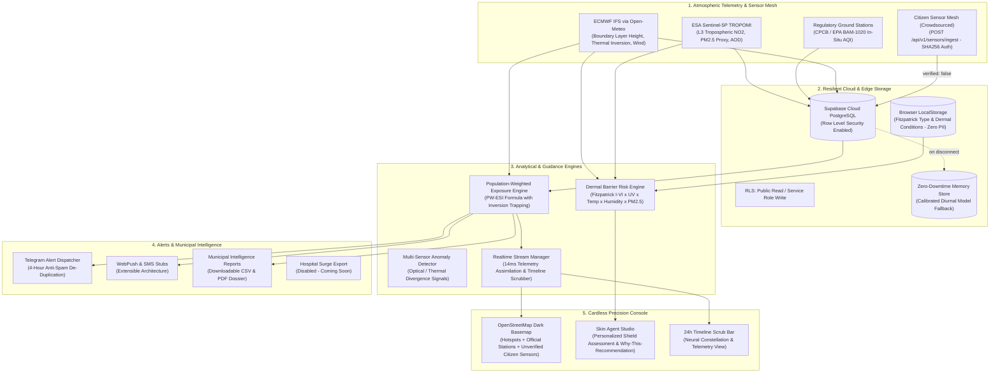

# 🌍 AtmosHealth – Planetary Health Geospatial Intelligence & Exposure Guidance

> **AI-powered planetary health platform uniting satellite observations (Copernicus Sentinel-5P), in-situ ground monitoring networks (CPCB / US EPA), meteorological boundary-layer dynamics (ECMWF IFS), and personalized dermal barrier vulnerability models into evidence-grade public health exposure guidance.**

---

## 🏛️ System Architecture



---

## 🔒 Non-Diagnostic Scope & Regulatory Boundaries

- **Strict Guidance Boundary**: AtmosHealth produces **evidence-based environmental exposure guidance only**. It strictly **does not provide clinical diagnosis, disease prediction, individual medical prescriptions, or clinical triage decision-making**.
- **Wording Standard**: Employs non-clinical exposure language (e.g., *"conditions today may stress your skin barrier"* or *"elevated particulate suspension detected; consider barrier cream"*).
- **Zero Health PII on Server**: Individual dermal barrier profiles (Fitzpatrick skin phototype I–VI, conditions like eczema, rosacea, sensitive skin) are stored exclusively in client-side `localStorage`. No personal health data ever touches the cloud database or server.
- **Traceability & Provenance**: Every metric card and report explicitly displays its sensor origin (Copernicus, CPCB, EPA, ECMWF) and a timestamped observation audit.
- **Strict Citizen Data Segregation**: All crowdsourced micro-sensor telemetry is flagged `verified = false` and stored in a separate table, permanently isolated from official regulatory layers.

---

## 🚀 Getting Started

### 1. Prerequisites
- **Node.js** >= 18.0.0
- **npm** >= 9.0.0

### 2. Installation
```bash
# Clone the repository
git clone <repo-url>
cd ESAI

# Install dependencies
npm install

# Setup environment variables
cp .env.example .env
```

### 3. Running the Test Suite
```bash
npm test
```
Executes all 5 comprehensive test suites:
- ✅ `tests/dermalRiskEngine.test.ts` (Fitzpatrick UV photoprotection, barrier stress multipliers, non-diagnostic disclaimers)
- ✅ `tests/alertsSystem.test.ts` (4-hour anti-spam de-duplication, Telegram formatting, WebPush/SMS stubs)
- ✅ `tests/citizenSensors.test.ts` (SHA-256 API key hashing, physical bound validation, rate limiting, `verified = false` flag)
- ✅ `tests/reportExport.test.ts` (Municipal CSV and JSON generation, hotspot matrix, provenance audit)
- ✅ `tests/apiRoutes.test.ts` (Core REST endpoints, error envelopes, and zero-downtime offline fallbacks)

### 4. Running the Development Server
```bash
npm run dev
```
Open **[http://localhost:3000](http://localhost:3000)** in your browser.

### 5. Production Build
```bash
npm run build
npm run start
```

---

## 🔑 Environment Variables Reference

See `.env.example` for the authoritative template.

| Variable | Required | Default / Example | Purpose |
| :--- | :---: | :--- | :--- |
| `DATABASE_URL` | **Yes** | `postgresql://...@pooler.supabase.com:6543/postgres?pgbouncer=true` | Supabase Cloud PostgreSQL pooled connection |
| `DIRECT_URL` | **Yes** | `postgresql://...@pooler.supabase.com:5432/postgres` | Supabase direct connection for migrations |
| `NEXT_PUBLIC_SUPABASE_URL` | **Yes** | `https://[PROJECT-REF].supabase.co` | Supabase API endpoint |
| `NEXT_PUBLIC_SUPABASE_ANON_KEY` | **Yes** | `eyJh...` | Public RLS client key |
| `SUPABASE_SERVICE_ROLE_KEY` | Optional | `eyJh...` | Cloud ingest & cron bypass key |
| `TELEGRAM_BOT_TOKEN` | Optional | `123456:ABC-DEF...` | Telegram Bot API token (uses mock console dispatch if omitted) |
| `CRON_SECRET` | Optional | `32-char-random-string` | Vercel Cron bearer token authentication |
| `PORT` | No | `3000` | Local port |

---

## 🧪 5-Step Demo & Verification Walkthrough

### Step 1: Cloud DB + Scheduled Ingestion
- **What it does**: Queries multi-regional satellite and ground telemetry every 2 hours via Vercel Cron (`vercel.json`) or manual invocation.
- **Verify**:
  ```bash
  curl http://localhost:3000/api/cron/ingest
  ```
  Returns `Inserted 18 observations across 6 regions (0 failures)` with exponential retry and diurnal offline fallback.

### Step 2: Personalized Dermal Barrier Profiles
- **What it does**: Click **Agent** view or the **Dermal Profile** pill in the header to select your Fitzpatrick Skin Phototype (I–VI) and optional barrier conditions (eczema, rosacea, sensitive skin).
- **Verify**:
  - The profile saves instantly to browser `localStorage` (zero PII sent over the wire).
  - The recommendation engine recalculates real-time barrier stress, explains *"Why this recommendation"* with exact inputs, and displays the non-diagnostic disclaimer.

### Step 3: Threshold Alerts (Telegram First)
- **What it does**: Click the **Alerts** bell button in the top navigation bar.
- **Verify**:
  - Subscribe to a region (e.g. Delhi NCR) and metric (PM2.5, AQI, UV, Heat).
  - De-duplication enforces a strict **4-hour cooldown** window to prevent alert fatigue.
  - Test evaluation via `POST /api/alerts/check` or unit tests (`tests/alertsSystem.test.ts`).

### Step 4: Citizen Sensor Ingest API
- **What it does**: Allows low-cost community air nodes to post readings via `POST /api/v1/sensors/ingest`.
- **Security**: Per-device SHA-256 API key authentication and sliding-window rate limiting (60 req/min).
- **Segregation**: Every crowdsourced record is permanently flagged `verified = false`.
- **Verify via Simulator**:
  ```bash
  node scripts/simulate-sensors.js
  ```
- **Verify on Map**: Open **Map** view and toggle **Citizen Sensors**. Notice amber dashed circles with the `UNVERIFIED` label.

### Step 5: Municipal Report Export
- **What it does**: Click **Generate report** in the top navigation bar.
- **Verify**:
  - Click **Export CSV**: downloads a formatted municipal dossier with hotspots, meteorological parameters, and traceability audit.
  - Click **Download PDF**: opens print-ready A4 stylesheet.
  - Note the disabled **Hospital surge export (Coming soon)** button reserved for future clinical clearance.

---

## 📄 License & Attribution
- Built with **Next.js 14**, **Tailwind CSS**, **Prisma ORM**, **Supabase**, and **Leaflet**.
- Satellite telemetry courtesy of **European Space Agency (ESA) & Copernicus CAMS Sentinel-5P**.
- Meteorological context courtesy of **ECMWF IFS / Open-Meteo**.
- Ground monitoring courtesy of **Central Pollution Control Board (CPCB)** and **US EPA AirNow**.
